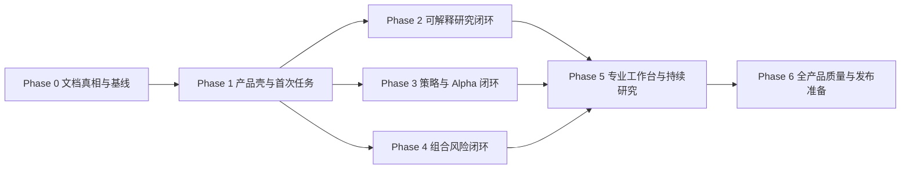

# FinQuant Hub 产品化总计划

> 文档类型：产品化长期执行总纲 / Goal Mode 入口  
> 状态：COMPLETE — PHASE 0–6  
> 版本：v1.1  
> 制定日期：2026-08-09  
> 适用范围：FinQuant Hub 现有 FastAPI + React 产品，不包含 `reference/` 目录  
> 核心目标：把当前“功能很多但难以理解”的量化工具集合，建设为新手可快速上手、专业用户可持续深入、数据和结论可验证的个人 AI 量化研究产品。

---

## 0. 如何使用本文档

本文档不是一次性 UI 改版清单，也不是允许无限扩张功能的愿望列表。它是后续新对话使用 Goal Mode 时的产品化执行总纲。

执行时遵循以下优先级：

1. 当前用户在新对话中明确下达的任务范围与安全要求。
2. `docs/ai/PROJECT_CONTRACT.md`、当前有效的架构不变量、`docs/ARCHITECTURE.md`、`docs/API_CONTRACT.md` 与 `docs/DATA_SOURCES.md`。
3. 本文档定义的产品目标、阶段顺序、验收标准和非目标。
4. `docs/ai/LONG_TERM_GOAL.md`、`docs/ai/GAP_ANALYSIS.md` 等历史路线图。

本文档只规定“产品为什么做、做成什么、按什么顺序验收”。具体编码任务仍应拆成 `docs/ai/tasks/TASK-NNN.md`，每次只执行最高优先级的 `[READY]` 任务。

### 0.1 阶段 0 的硬前置

本文档启动时存在需要先处理的事实冲突：

- `docs/ai/ARCHITECTURE.md` 仍描述“无认证、14 路由”等旧不变量。
- `docs/ARCHITECTURE.md` 和当前代码已经包含邮箱认证、本地单用户模式、用户数据隔离及更多路由。

`PROD-000` 已于 2026-08-09 完成文档对齐：`docs/ARCHITECTURE.md` 是完整权威来源，`docs/ai/ARCHITECTURE.md` 只保留实现硬边界；当前代码事实为 23 个 APIRouter、schema v11，并保留认证、用户隔离和仅 development 可用的本地所有者模式。后续若这些事实漂移，必须重新打开 `PROD-000`，在再次统一前不得修改产品化业务代码。

### 0.2 永久红线

- 不修改 `reference/`。
- 不编造行情、财务、评级、回测或新闻数据。
- 数据缺失必须显示 `unknown`、不可用原因、来源状态和截止时间，不能填 0 掩盖。
- 不把单季度数据伪装成 TTM，不混淆报告期、交易日和抓取时间。
- 不实现真实券商账户、资金查询或订单提交；相关连接器保持评估或只读设计。
- 不以“专业”为理由把术语、公式和几十个指标平铺到首屏。
- 不为视觉效果引入新的大型依赖；优先复用 Ant Design、ECharts、lightweight-charts 和现有组件。
- 不因产品化改造重写后端架构、引入 ORM、连接池、WebSocket、SSR 或 DI 容器。
- 不自动提交、推送、发布或部署；这些动作必须在执行当时获得用户确认。

---

## 1. 产品北极星

### 1.1 一句话定位

FinQuant Hub 是一个面向中文个人投资者的 AI 量化研究工作台：用户可以从一个股票、一个策略或一个持仓组合出发，获得带真实数据来源、量化验证、风险说明和持续跟踪记录的研究结论。

### 1.2 产品承诺

产品必须同时兑现四个承诺：

1. **30 秒看懂**：用户能立即知道产品能解决什么问题、从哪里开始。
2. **5 分钟获得第一次价值**：无需配置复杂参数即可完成一次真实标的分析、策略回测或组合体检。
3. **逐层深入**：同一结果可以从通俗摘要展开到数据证据、计算方法和专业参数。
4. **可以复盘**：每次研究、策略和组合判断都能保存、比较、更新并看到观点变化。

### 1.3 产品不是什么

- 不是行情大屏模板展厅。
- 不是把 API、Agent、MCP、模型配置直接暴露给普通用户的工程控制台。
- 不是只给结论、不提供来源和反面证据的荐股工具。
- 不是指标越多越专业的量化百科。
- 不是自动交易或收益承诺产品。

### 1.4 北极星行为

用户完成以下闭环，才算真正获得产品价值：

```text
提出问题 → 获取真实数据 → 得到可解释结论 → 验证风险与稳健性
→ 保存研究 → 后续更新 → 比较观点变化 → 形成个人研究资产
```

---

## 2. 当前产品诊断

### 2.1 已有优势

- A 股、港股、美股统一标的和多源行情降级链。
- 技术指标、信号识别、综合评分和个股图表。
- AI 对话、多角色讨论、深度研究、结构化报告和投资论文追踪。
- 单标的与组合回测、A 股交易规则、基准比较和统计稳健性验证。
- Alpha 字段、模板、本地模拟和可选 WorldQuant BRAIN 桥接。
- 投资组合、风险 X 光、优化器、预警、通知和持久化。
- 来源、截止时间、质量标记、未知状态和不构成投资建议的边界意识。

### 2.2 系统性问题

1. **导航以模块为中心**：仪表盘、对话、讨论、研究、策略、Alpha、模型、MCP 等入口同级，用户无法判断先后关系。
2. **首屏价值错位**：空组合大屏和市场雷达占据首屏，真正的启动引导位于下方。
3. **结果解释不足**：专业指标已存在，但没有通俗解释、参考区间、主要失败原因和下一步建议。
4. **学习与操作分离**：知识库能讲策略，策略实验室能回测，但缺少连续的“学完立即做、做完立即解释”。
5. **后端能力未产品化**：Alpha 模板/模拟、组合回测/风险 X 光等能力没有形成完整前端工作流。
6. **AI 能力边界不清**：普通用户不容易理解何时用对话、讨论、深度研究或 Swarm。
7. **专业页面缺少工作流**：Alpha 页面更像字段搜索器，Portfolio 更像持仓 CRUD，未体现研究生命周期。
8. **视觉层级不稳定**：大屏风格、普通 AntD 卡片、英文 eyebrow、内部信号代码和长表格混用。
9. **空状态缺少任务**：许多页面只告诉用户“暂无数据”，没有一键示例或下一步。
10. **历史规划偏功能补齐**：Phase 1-9 已补齐大量能力，但缺少以用户理解速度和任务完成率为中心的产品化阶段。

### 2.3 核心判断

下一阶段不应继续以“再增加一批页面/指标”为主线。正确顺序是：

1. 先统一产品语言与用户任务。
2. 再把已有能力接成闭环。
3. 然后补足决定分析质量的关键指标。
4. 最后开放专业定制和高级研究能力。

---

## 3. 目标用户与任务

产品使用同一套真实数据和计算结果，通过渐进披露兼顾不同用户，不维护割裂的两套系统。

### 3.1 入门用户

**特征**：知道股票和收益率，但不熟悉量化指标、策略参数和统计检验。  
**核心任务**：快速理解一只股票、验证一个简单策略、看懂自己的持仓风险。  
**默认体验**：任务模板、示例数据、通俗结论、少量关键指标、明确下一步。  
**成功标准**：能够回答“发生了什么、为什么、主要风险是什么、下一步做什么”。

### 3.2 研究型投资者

**特征**：关注基本面、估值、行业、技术面和投资逻辑，希望积累长期研究记录。  
**核心任务**：建立研究工作区、交叉验证、追踪投资论文、比较观点变化。  
**默认体验**：摘要、证据、反面观点、数据来源、财务趋势、提醒和复盘。

### 3.3 量化进阶用户

**特征**：理解回测、风险调整收益、因子和组合优化，希望控制参数和查看方法。  
**核心任务**：构建与比较策略、验证 Alpha、分析组合风险、导出研究结果。  
**默认体验**：高级参数、公式、样本信息、稳健性检验、数据质量和可复现实验。

### 3.4 系统维护者

**特征**：需要管理数据源、模型、MCP、调度、通知和系统状态。  
**核心任务**：保证产品可用性，而不是参与日常研究。  
**默认体验**：系统工具归入二级入口，不与用户核心任务竞争首屏注意力。

---

## 4. 产品设计原则

### 4.1 任务优先于模块

入口使用“分析一只股票”“验证一个策略”“体检一个组合”等用户语言。API、Agent、模型和数据源只在需要时出现。

### 4.2 结果优先于参数

默认先给结论、风险和下一步。参数、公式、交易明细和原始数据放入“证据”和“方法”层。

### 4.3 同一数据，三层表达

所有核心结果统一为：

1. **摘要**：通俗结论、三项原因、主要风险、下一步。
2. **证据**：图表、财务指标、信号、基准比较和反面证据。
3. **方法**：公式、参数、样本、数据质量、统计检验和计算口径。

### 4.4 在上下文中学习

不使用强制式全屏教程作为主要 onboarding。用户遇到某个指标或步骤时再提供解释、示例和知识链接。

### 4.5 优先接线，不重复建设

已有后端能力必须先检查能否直接产品化。没有证据证明现有能力不足前，不重写计算逻辑、不引入新依赖。

### 4.6 可信度是产品功能

来源、截止时间、期间类型、复权、币种、时区、质量标记、缺失原因和推断方法必须可见。

### 4.7 专业不是信息堆积

专业性来自方法正确、边界明确、结果可复现，而不是一屏展示几十个缩写。

### 4.8 每个空状态都必须能开始任务

空状态至少提供一个真实示例、一项推荐动作和“为什么做”的解释。

### 4.9 每个结论都必须允许反驳

AI 或量化评分必须同时显示主要反面证据、最脆弱假设和会改变结论的新信息。

### 4.10 用完成率验证设计

页面是否更漂亮不是最终验收；用户能否更快完成任务、理解结果并保存研究才是验收。

---

## 5. 目标信息架构

### 5.1 一级导航

一级导航从当前大量功能入口收敛为六组：

| 一级入口 | 用户问题 | 包含能力 |
|---|---|---|
| 今日 | 我现在最值得看什么、下一步做什么？ | 任务启动台、市场脉搏、待办、最近研究、预警摘要 |
| 研究 | 这家公司值不值得继续研究？ | 个股分析、研究工作区、深度研究、AI 问答、多视角讨论、投资论文 |
| 策略 | 这个想法经过历史验证吗？ | 策略实验室、选股器、Alpha 因子、回测历史、策略比较 |
| 组合 | 我的资产暴露和主要风险是什么？ | 持仓、盈亏、配置、风险 X 光、优化模拟、预警 |
| 知识 | 如何在当前任务中理解概念？ | 知识库、指标说明、上下文学习入口 |
| 系统工具 | 系统如何配置和维护？ | 模型、MCP、数据源、通知、设置 |

专业用户可以固定常用页面，但默认导航不恢复为十几个同级菜单。

### 5.2 全局任务入口

在桌面端 Header 提供统一搜索/命令入口，支持：

- 输入股票代码或公司名称。
- 输入自然语言问题。
- 直接选择“分析、回测、加入组合、创建论文、设置预警”。
- 最近访问和已保存研究。

全局入口只负责路由和预填，不应在用户未确认时自动消耗模型额度或提交外部模拟。

### 5.3 页面标准结构

每个核心业务页面按统一顺序组织：

```text
页面目标 + 当前对象 + 数据状态
→ 下一步主操作
→ 结论摘要
→ 证据
→ 方法与数据来源
→ 保存、比较、跟踪
```

### 5.4 导航映射原则

- “模型”“MCP 工具”“设置”属于系统维护，不占据普通用户研究路径的一级注意力。
- “对话”“讨论”“深度研究”是研究方式，不是互相竞争的产品主入口。
- “投资论文”是研究结果的持续跟踪形态，应从研究结果页创建，也可在研究分组中集中查看。
- “预警”既可以从组合创建，也可以从标的、指标和论文创建；集中页负责管理，不负责首次发现。

---

## 6. 六条核心用户旅程

### 6.1 首次使用：5 分钟完成一项真实任务

1. 首页选择“分析一只股票”。
2. 使用示例 `600519`、`00700.HK` 或 `AAPL`，也可输入自己的标的。
3. 系统加载行情、指标、基本面和来源状态。
4. 首屏给出一句话结论、三项证据、主要风险和数据质量。
5. 用户展开一个指标解释。
6. 用户保存研究或选择“用策略验证”。

**完成信号**：首次分析成功、用户看过解释、完成保存或进入下一任务。

### 6.2 个股研究闭环

```text
搜索标的 → 快速判断 → 查看基本面/技术面/新闻证据
→ 运行多视角研究 → 查看分歧和反证 → 保存为研究工作区
→ 创建投资论文 → 设置验证条件和预警 → 后续更新与观点漂移
```

### 6.3 策略验证闭环

```text
选择策略预设 → 选择标的与周期 → 使用合理默认成本
→ 运行回测 → 先判断是否跑赢基准、风险是否可接受、样本是否可靠
→ 展开专业指标与稳健性 → 比较另一个预设或修改一个参数
→ 保存实验和结论
```

### 6.4 Alpha 研究闭环

```text
选择因子类别/模板 → 阅读通俗解释 → 查看表达式与字段来源
→ 使用真实或明确提供的观察数据运行本地模拟
→ 查看分位收益、稳定性、换手和样本覆盖
→ 与其他因子比较 → 保存研究
→ 可选且显式确认后提交外部 BRAIN 模拟
```

### 6.5 组合风险闭环

```text
导入/维护持仓 → 查看收益与配置 → 运行风险体检
→ 找到最大集中度、尾部风险和相关性来源
→ 查看等权/风险平价/均值方差等模拟方案
→ 比较优化前后，不自动修改真实持仓
→ 保存体检结果并设置预警
```

### 6.6 学习闭环

```text
在任务中遇到概念 → 打开上下文解释 → 查看短示例
→ 在当前真实数据上观察 → 进入知识条目深入学习
→ 一键返回原任务继续操作
```

---

## 7. 页面级产品化方向

### 7.1 今日 / Dashboard

**目标**：从“数据大屏”变为“任务启动台”。

首屏必须包含：

- 欢迎语与当前系统/数据状态。
- 三个主任务：分析股票、验证策略、体检组合。
- 一个可直接运行的真实示例。
- 新用户进度：完成第一次分析、第一次回测、第一次保存。
- 最近研究、需要关注的预警和待继续任务。

调整：

- 空组合大屏、地图和市场雷达下移到“市场与监控”。
- 市场异动明确标注“发现候选，不等于研究结论”。
- “五项能力启动测试”改为可持续的任务进度，而不是一次性系统自检卡。

### 7.2 个股分析

**目标**：从指标图表页变为快速判断入口。

必须提供：

- 当前结论：偏强/中性/偏弱，以及判断时间尺度。
- 看多证据、看空证据和冲突信号。
- 内部信号代码翻译为中文名称和描述，不直接显示 `volume_surge` 等实现标识。
- 技术评分的权重、区间和局限。
- “为什么”“查看原始指标”“继续深度研究”“用策略验证”操作。

### 7.3 研究工作区

**目标**：成为单个标的所有研究活动的主容器。

统一承载：

- 行情与基本面快照。
- AI 深度报告及引用。
- 多视角讨论与分歧。
- 研究笔记、投资论文和验证条件。
- 历史版本、数据刷新和观点变化。

删除“原多智能体报告”等实现历史语言，改为“运行多视角深度研究”。

### 7.4 AI 对话与讨论

**目标**：让用户先选研究意图，而不是理解 Agent 架构。

统一入口提供三种强度：

- 快速问答：解释一个问题。
- 深度研究：生成带来源的结构化报告。
- 多视角审查：主动寻找分歧、反证和脆弱假设。

高级用户可以查看角色、工具调用和模型；普通用户只看到任务差异、预计耗时和是否消耗模型额度。

### 7.5 策略实验室

**目标**：让新手使用合理预设，让专业用户控制参数。

默认模式：

- 先选目标：趋势跟随、均值回归、风险控制。
- 再选预设和标的。
- 高级费用、均线和风控参数折叠。
- 运行前用自然语言总结本次假设。

结果顺序：

1. 是否跑赢基准。
2. 最大损失与恢复情况。
3. 结论是否稳定。
4. 数据和交易规则是否可信。
5. 专业指标、图表和交易明细。

### 7.6 Alpha 因子

**目标**：从字段搜索器升级为因子研究台。

必须接入现有：

- `/api/wq/categories`
- `/api/wq/templates`
- `/api/wq/simulate/local`
- `/api/wq/correlation`

默认提供 3-5 个可解释模板，展示字段是否真实存在、适用区域、表达式和局限。外部 BRAIN 操作必须保持显式确认。

### 7.7 投资组合

**目标**：从持仓管理页升级为风险决策页。

在现有盈亏和配置基础上增加：

- 集中度和有效资产数。
- 最大/当前回撤。
- VaR/ES 与样本状态。
- 资产相关性和分散化收益。
- 优化模拟前后对比。
- 行业、市场、币种暴露；数据拿不到时明确缺口。

任何优化结果都只作为研究模拟，不生成真实交易指令。

### 7.8 知识库

**目标**：从独立文档集合变为任务中的学习层。

- 保留策略知识条目。
- 给每个指标、风险概念和研究方法提供稳定锚点。
- 支持从结果页跳入，并带着当前标的/参数上下文。
- 支持一键返回原任务。
- 明确区分“教学示意数据”和“真实行情回测”。

### 7.9 预警与投资论文

**目标**：形成持续研究和复盘，而不是孤立功能。

- 从研究结论一键创建论文。
- 从指标、价格、基本面、报告变化创建验证条件。
- 预警说明触发原因、原始数据和关联论文。
- 通知点击后回到具体证据，不只进入通知列表。

---

## 8. 金融量化指标体系

### 8.1 指标建设原则

每个指标进入产品前必须回答：

1. 它帮助用户做什么判断？
2. 当前数据源是否真实可得？
3. 计算口径、频率和样本是否明确？
4. 是否有参考基准或可比较对象？
5. 数值不可用时如何表示？
6. 是否能用一句通俗语言解释？

不满足以上条件的指标不得仅为了“数量看起来多”进入首屏。

### 8.2 现有可见能力

- 技术：MA、MACD、RSI、KDJ、BOLL、ATR、VolMA。
- 基本面：营收、净利润、经营现金流、自由现金流、毛利润、资产、负债、权益、EPS、ROE、毛利率、净利率、资产负债率、流动比率、营收/净利增长等，具体取决于来源。
- 回测：总收益、年化收益、基准收益、超额收益、最大回撤、Sharpe、Sortino、Calmar、信息比率、胜率、盈亏比、换手、交易数。
- 稳健性：Bootstrap、Monte Carlo、Walk-forward。
- 市场：广度、板块/题材、资金、异动和热度，并保留来源可用性。

### 8.3 已存在但需要前端产品化

- Alpha 类别、模板、本地多空模拟、Pearson 相关。
- 组合回测和四类优化器：等权、风险平价、均值方差、逆波动。
- 组合风险 X 光：HHI、有效资产数、最大/当前回撤、历史 VaR、ES、平均相关性和分散化收益。
- 投资论文漂移检测、报告审计、估值验算和对抗式审查。

这些能力应先形成用户工作流，再评估是否新增替代实现。

### 8.4 P1 必备补充指标

| 领域 | 指标 | 产品用途 |
|---|---|---|
| 回测风险 | 年化波动率、下行波动率、回撤持续期、恢复期 | 解释策略为收益承担了多少波动和时间成本 |
| 基准归因 | Beta、Alpha、R²、Tracking Error | 区分策略收益来自市场暴露还是独立贡献 |
| 交易质量 | 单笔期望、平均盈利/亏损、平均持有期、市场暴露、费用归因 | 判断策略是否依赖少数交易或被成本吞噬 |
| 估值 | EV/EBITDA、EV/Sales、FCF Yield、PEG、股息率 | 补齐仅看 PE/PB 的局限 |
| 经营质量 | ROIC、ROA、杜邦分解、CFO/净利润、FCF Margin | 区分账面利润和现金质量 |
| 偿债风险 | 净负债/EBITDA、利息覆盖、速动比率 | 解释资产负债率之外的偿债能力 |
| 技术趋势 | ADX/DMI、VWAP/AVWAP、Donchian | 补齐趋势强度、成交成本锚和突破区间 |
| 量价 | OBV、CMF、MFI、成交额/换手趋势 | 补齐资金与量价确认 |

### 8.5 P2 专业研究指标

| 领域 | 指标/能力 | 说明 |
|---|---|---|
| Alpha 有效性 | IC、Rank IC、ICIR、分位组合收益、多空价差 | 判断因子预测能力和单调性 |
| Alpha 稳定性 | 衰减、换手、覆盖率、缺失率、样本外表现 | 防止只看单次回测 |
| 因子处理 | 去极值、标准化、行业/市值中性化、多因子回归 | 进入专业模式，不默认暴露给新手 |
| 组合风险 | 边际/成分风险贡献、相关性热图、风险预算 | 解释每个资产贡献的风险而非只看权重 |
| 压力测试 | 历史情景、自定义冲击、利率/汇率/市场跌幅 | 只使用可解释假设，不伪装成预测 |
| 技术扩展 | ROC、CCI、Williams %R、Ichimoku、Keltner、Parabolic SAR | 按真实策略需求逐项加入，不一次铺满 |
| 财务质量 | Piotroski F-Score、Altman Z、应计质量、现金转换周期 | 必须显示公式版本、适用行业和数据完整度 |

### 8.6 统一指标卡合同

所有新旧指标统一展示字段：

```text
中文名 / 英文缩写
当前值与方向
一句话解释
它回答的问题
参考基准或比较对象
计算方法与参数
数据源、截止时间、频率、币种、复权
质量状态与缺失原因
局限与失真场景
```

---

## 9. AI 产品化合同

### 9.1 AI 输出结构

AI 研究默认遵循：

1. 一句话结论。
2. 三项最重要证据。
3. 主要反面证据。
4. 最大不确定性和数据缺口。
5. 会改变结论的条件。
6. 来源与截止时间。
7. 推荐的下一项研究动作。

### 9.2 工具与来源可见性

- 用户可以看到调用了哪些数据/计算工具，但普通模式不展示原始 function schema。
- 每个关键数字可以回到来源或计算方法。
- AI 不得把推断值展示成提供方原始值。
- 多 Agent 结果必须区分共识、分歧和未解决问题。

### 9.3 成本和外部动作

- 免费/本地计算可以直接运行。
- 消耗模型额度的任务在启动前显示预计行为并由用户确认。
- WorldQuant BRAIN 等外部提交必须显式确认。
- 计划、研究和回测永远不构成真实交易授权。

### 9.4 AI 失败状态

- 模型不可用时保留非 AI 的行情、指标、回测和已保存研究能力。
- 工具调用失败必须显示具体数据缺口，不以通用分析文本替代。
- 报告部分失败时保留成功章节和每章状态，不把整份报告伪装为完整。

---

## 10. 入门到精通体系

### 10.1 新手任务路径

按任务而非课程章节推进：

1. 分析第一只股票。
2. 看懂一个技术信号和一个基本面指标。
3. 运行第一次带基准的回测。
4. 找到一个回测风险或数据警告。
5. 保存第一次研究。
6. 创建一个验证条件或预警。

### 10.2 中级研究路径

1. 对同一标的运行多视角研究。
2. 区分事实、推断和 AI 判断。
3. 创建投资论文和反证条件。
4. 比较两种策略预设。
5. 完成组合风险体检。

### 10.3 专业路径

1. 自定义回测参数和成本。
2. 阅读统计稳健性和样本外结果。
3. 创建/验证 Alpha 因子。
4. 分析组合风险贡献和情景压力。
5. 导出可复现的研究记录。

### 10.4 引导形式

- 可跳过的任务进度，而非强制 tour。
- 页面内“为什么重要”和“如何解读”。
- 首次出现术语时给出简短解释，之后保持安静。
- 示例必须运行真实产品链路，不做只会播放的假演示。
- 完成任务后建议一个自然的下一步，不一次展示整条课程树。

---

## 11. 视觉与交互系统

### 11.1 统一风格

- 研究工作台为主风格，大屏监控为特定场景，不让深色大屏支配整个产品。
- 保持 Ant Design 组件语义和交互一致性。
- 英文 eyebrow 只作为次要辅助，不承担主要信息。
- 不使用内部代码、缩写或 emoji 代替正式产品文案和图标。

### 11.2 信息密度

- 新手默认显示 3-5 个关键指标。
- 其余指标按收益、风险、稳定性、交易质量分组展开。
- 专业用户可以保存密度偏好和常用指标，但不改变数据口径。

### 11.3 图表

- 每张图回答一个明确问题。
- 标题说明比较对象、时间范围和单位。
- 颜色之外还要有标签、线型或符号区分。
- 空数据、数据截断、复权和样本不足必须在图旁显示。
- 图表需要文字摘要，保证无法读取图形时仍能理解主要结论。

### 11.4 空、错、加载状态

每个状态必须回答：

- 发生了什么。
- 是否影响结论。
- 用户可以做什么。
- 是否可以使用示例或稍后重试。

### 11.5 无障碍基线

- 可见焦点和完整键盘路径。
- 表单具有标签、帮助和可恢复错误。
- 文字和状态不只依赖颜色。
- 关键点击目标不低于合理尺寸。
- 支持 200% 缩放和窄屏重排。
- 图表提供语义标题和文字摘要。

---

## 12. 数据可信度与金融正确性

### 12.1 来源合同

每份研究结果必须能追踪：

- provider/source
- as_of / report_period / fetched_at
- period_type
- currency / timezone / frequency
- adjustment
- quality_flags
- methodology

### 12.2 质量状态

统一使用并解释：

- `VERIFIED`：来源和口径可验证。
- `PARTIAL`：部分字段或期间缺失。
- `INFERENCE`：明确由模型或算法推断。
- `STALE`：超过页面定义的新鲜度。
- `UNKNOWN`：没有足够证据。
- `UPSTREAM_ERROR`：提供方失败。

具体枚举应复用现有数据合同；若当前实现名称不同，先统一文档再改 UI。

### 12.3 回测可信度

- 明确基准、交易频率、复权、佣金、滑点、税费和强制平仓规则。
- A 股规则显示 T+1、涨跌停和禁做空状态。
- 交易样本少、期间短、数据未复权或混合频率时降低结论强度。
- 参数优化和结果比较防止前视偏差；校准窗口不得泄露到测试窗口。
- 统计模拟返回区间和概率，不把随机结果写成确定结论。

### 12.4 AI 可信度

- 关键事实必须引用数据或来源。
- 相关性不得表述为因果。
- 机构评级、护城河或星级等许可数据不可自行替代。
- 新闻相关性不足时宁可拒绝，不伪装为标的证据。

---

## 13. 产品指标与本地测量

个人本地产品不需要引入外部分析 SDK。可使用本地、可关闭、无敏感正文的聚合事件记录，或先通过人工可用性测试建立基线。

### 13.1 核心产品指标

| 指标 | 定义 | 目标方向 |
|---|---|---|
| Time to First Value | 首次打开到完成一次真实分析/回测/体检 | ≤ 3 分钟 |
| First Task Completion | 新用户首次会话完成至少一个核心任务 | 持续提升 |
| Result Comprehension | 用户能回答结论、原因、风险和下一步 | ≥ 80% |
| Research Save Rate | 完成研究后保存为工作区/论文的比例 | 持续提升 |
| Workflow Continuation | 分析后继续回测、研究或预警的比例 | 持续提升 |
| Repeat Research | 7 日内重新打开或更新已保存研究 | 持续提升 |

### 13.2 可信度指标

- 带来源的关键数字比例。
- 数据缺失被正确标记而非填 0 的比例。
- 回测显示成本、基准和数据警告的比例。
- AI 报告包含反面证据和未知项的比例。
- 来源失败时仍诚实降级的成功率。

### 13.3 性能指标

- 产品壳和首个任务入口应快速可交互。
- 行情/指标类任务尽快返回可用部分，不等待 AI 才显示。
- SSE 过程显示当前步骤、已完成部分和可取消状态。
- 动画不得拖慢首屏或阻止操作。

---

## 14. 分阶段执行路线图

阶段不以日历时间为完成标准，只以退出门槛为准。前一阶段未通过，不进入依赖它的下一阶段。



### Phase 0 — 文档真相与产品基线

**目标**：让长期执行建立在当前代码和架构事实之上。

任务：

- `[DONE] PROD-000`：核对 `docs/ai/ARCHITECTURE.md`、`docs/ARCHITECTURE.md`、代码路由、认证和数据表，修正文档冲突并记录决策。
- `[DONE] PROD-001`：建立当前页面/流程/指标能力矩阵，区分“已展示、后端已有未展示、真正缺失、不可行”。
- `[DONE] PROD-002`：记录桌面主流程基线截图和首个任务完成步骤数。
- `[DONE] PROD-003`：定义本地产品指标的最小测量方式，不引入外部追踪依赖。

退出门槛：

- 架构文档无相互冲突的硬不变量。
- 当前路由、页面和数据能力清单可由代码验证。
- P0 产品任务具有可测量基线。
- 没有业务代码改动混入文档对齐任务。

Phase 0 已于 2026-08-09 通过退出门槛：架构真相、代码能力矩阵、桌面/窄屏截图与步骤基线、本地产品指标合同均可复核；Phase 0 未修改业务代码。

### Phase 1 — 产品壳与首次任务

**目标**：用户 30 秒知道做什么，3 分钟内完成第一项真实任务。

任务：

- `PROD-010`：六组一级导航与路由映射。
- `PROD-011`：Dashboard 任务启动台，市场大屏下移。
- `PROD-012`：分析股票、验证策略、体检组合三个真实示例任务。
- `PROD-013`：首次任务进度和可跳过上下文帮助。
- `PROD-014`：统一页面标题、对象、数据状态和主操作结构。
- `PROD-015`：全局标的/任务入口，仅负责路由和预填。

退出门槛：

- 新用户无需打开帮助即可完成一项任务。
- 14+ 个功能入口不再同级竞争。
- 空状态均有可执行下一步。
- 原有所有页面仍可访问，无路由丢失。
- 桌面和窄屏核心导航通过浏览器验证。

Phase 1 已于 2026-08-09 通过产品退出门槛：六组导航、首屏任务、三个真实示例、本地首次进度、四页任务头和全局任务入口均可复核；所有写操作仍需用户确认。2026-08-16 的 AIOS-088 运行验收补充了陈旧本地镜像检测，并把不存在权威跨标的聚合合同的市场信号明确保持为 `UNKNOWN`。

### Phase 2 — 可解释研究闭环

**目标**：把个股分析、深度研究、讨论和投资论文串为一个持续研究流程。

任务：

- `PROD-020`：统一“摘要 / 证据 / 方法”结果框架。
- `PROD-021`：个股信号中文化、时间尺度和冲突解释。
- `PROD-022`：指标解释卡与知识锚点。
- `PROD-023`：研究工作区聚合快照、报告、分歧、笔记和历史版本。
- `PROD-024`：AI 意图入口：快速问答、深度研究、多视角审查。
- `PROD-025`：从研究结论创建论文、验证条件和预警。
- `PROD-026`：基本面/估值 P1 指标按真实数据可用性补齐。

退出门槛：

- 用户能从任一标的完成“分析 → 深研 → 保存 → 跟踪”。
- 关键结论可追踪来源、截止时间和反面证据。
- 内部信号代码不再作为主要产品文案。
- AI 不可用时非 AI 研究能力仍可使用。

Phase 2 已于 2026-08-09 通过产品退出门槛：个股分析、深研、保存、论文、验证条件与预警形成可复核链路；信号中文化、来源/截止时间、观点变化和真实数据 UNKNOWN 边界均有测试与浏览器证据。

### Phase 3 — 策略与 Alpha 闭环

**目标**：从“能跑回测/能查字段”升级为“能形成、验证和比较研究假设”。

任务：

- `PROD-030`：策略目标与预设选择，高级参数渐进披露。
- `PROD-031`：回测结论摘要、失败原因排序和指标解释。
- `PROD-032`：预设比较、单参数变化和保存实验。
- `PROD-033`：接入 Alpha 类别、模板和通俗说明。
- `PROD-034`：接入本地 Alpha 模拟和相关性。
- `PROD-035`：P1 回测风险、基准归因和交易质量指标。
- `PROD-036`：P2 Alpha IC、分位、衰减等能力评估；数据不足时保持设计状态，不伪造结果。
- `PROD-037`：本地 Alpha 研究命名、保存和刷新恢复；不持久化用户未显式保存的观察输入。

退出门槛：

- 新手可以只使用预设完成回测并理解结论。
- 专业用户可以查看参数、成本、稳健性和交易明细。
- Alpha 页面完成“模板 → 模拟 → 解释 → 保存”本地闭环。
- 外部 BRAIN 提交仍需要显式确认。

Phase 3 已于 2026-08-09 通过产品退出门槛：策略预设、解释、比较和保存形成可复核闭环；Alpha 真实模板、显式观察模拟、共同日期相关性、P2 数据边界和本地派生快照可恢复，原始观察输入不自动持久化，BRAIN 仍无隐式提交入口。

### Phase 4 — 组合风险闭环

**目标**：让 Portfolio 从持仓 CRUD 变为风险决策工具。

任务：

- `PROD-040`：接入现有组合回测和风险 X 光。
- `PROD-041`：集中度、回撤、VaR/ES 和分散化通俗解释。
- `PROD-042`：组合相关性和风险来源可视化。
- `PROD-043`：四种优化器的模拟比较，不修改真实持仓。
- `PROD-044`：行业、市场和币种暴露数据可行性与缺口显示。
- `PROD-045`：组合风险到预警和定期复盘的闭环。

退出门槛：

- 用户能指出组合最大的风险来源。
- 风险数据不足时显示样本状态，不返回虚假数值。
- 优化前后比较包含收益、风险、换手和假设。
- 任何优化结果都不产生真实订单。

Phase 4 已于 2026-08-09 通过产品退出门槛：Portfolio 以真实组合完成只读风险体检、通俗解释、风险来源/暴露和四优化器固定口径比较；风险证据可显式预填至 Alerts 或形成可恢复的本地复盘待办，所有动作都不自动创建规则、通知、订单或修改真实持仓。

### Phase 5 — 专业工作台与持续研究

**目标**：让进阶用户长期沉淀可复现研究，而不破坏新手体验。

任务：

- `PROD-050`：保存常用指标、布局密度和研究模板。
- `PROD-051`：跨标的/策略/组合比较工作区。
- `PROD-052`：研究版本、参数、来源和方法导出。
- `PROD-053`：P2 因子、风险贡献和压力测试能力按数据证据逐项实现。
- `PROD-054`：论文更新、观点漂移和研究待办统一时间线。
- `PROD-055`：系统工具与普通产品入口彻底分层。

退出门槛：

- 专业配置可保存但不改变底层数据口径。
- 研究可复现：对象、期间、参数、来源和版本齐全。
- 新手首屏没有因专业能力扩展而重新变复杂。

Phase 5 已于 2026-08-09 通过产品退出门槛：专业偏好、比较工作区和 schema v1 可复现清单保留来源与 `UNKNOWN` 边界；Alpha/组合只实现有真实合同的 IC、相关矩阵和风险贡献，持续研究时间线区分后端与本地记录；Models、MCP 与 Settings 收拢到独立系统工具层，不再成为普通任务前置步骤。

### Phase 6 — 全产品质量与发布准备

**目标**：完成体验、一致性、无障碍、性能和金融正确性的全故事验证。

任务：

- `PROD-060`：核心路径 E2E 与错误/空状态回归。
- `PROD-061`：键盘、焦点、对比度、缩放和图表文字摘要审计。
- `PROD-062`：首屏、图表和长列表性能优化。
- `PROD-063`：真实 A/HK/US 数据和来源失败回归。
- `PROD-064`：金融指标口径、期间、复权、成本和基准审计。
- `PROD-065`：文档、截图、API 合同和任务清单同步。

退出门槛：

- 三条主旅程和三条专业旅程端到端通过。
- 后端、前端、构建、类型、E2E 和浏览器验收全部通过。
- 没有伪造值、静默失败或来源不明的关键指标。
- 产品指标相比 Phase 0 基线有明确改善。

Phase 6 已于 2026-08-09 通过退出门槛：三条核心旅程具备确定性成功/空/错误回归和最终只读浏览器证据；后端 392 tests / 83.51% coverage、Ruff、mypy、前端 121 tests、Playwright 11 tests、TypeScript/生产构建与 diff check 全部通过。首视口任务从 0/3 改善为桌面/窄屏 3/3，三条核心初始路由资产减少 41.36%–41.71%；来源、`UNKNOWN`、金融口径和当前 AkShare/Yahoo 上游失败均保持可见。最终清单见 `artifacts/productization/phase6/PRODUCTIZATION_RELEASE_CHECKLIST.md`；本轮未提交或发布。

---

## 15. 任务拆分与 Goal Mode 执行规则

### 15.1 一次只推进一个可验证用户结果

每个任务卡必须包含：

```text
任务编号与标题
用户问题
当前证据/截图
目标行为
范围内文件
明确非目标
数据与金融口径
交互状态：正常/加载/空/错误/部分成功
可访问性要求
测试与浏览器验收
文档同步项
完成定义
回滚方式
```

### 15.2 任务大小

- 一个任务只解决一个完整用户结果。
- 跨多个核心页面的改造先拆共享合同，再逐页迁移。
- Bug 修复先写复现测试并检查所有调用者。
- 不在同一任务顺手重构无关模块。
- 大型视觉调整先有截图证据和目标稿，再编码。

### 15.3 状态规则

- `[PROPOSED]`：方向存在，但范围/证据不完整。
- `[READY]`：范围、验收、依赖和红线均明确，可以执行。
- `[IN PROGRESS]`：当前唯一进行中的任务。
- `[BLOCKED]`：经过充分排查仍需要用户/架构决策。
- `[DONE]`：代码、测试、浏览器、文档全部验证完成。

不允许因为“代码写完”或“构建通过”直接标记 `[DONE]`。

### 15.4 工作树纪律

- 开工前读取 `git status --short`，区分用户已有改动。
- 不覆盖、不清理、不格式化无关脏文件。
- 计划阶段禁止修改业务代码。
- 需要删除时遵守回收站规则，不永久删除。
- 提交、推送和发布等待用户确认。

---

## 16. 验证门槛

### 16.1 每个任务的最小门槛

- 新逻辑具有单元测试或可运行的确定性检查。
- 相关调用者和错误路径被覆盖。
- 正常、加载、空、错误、部分成功状态均有验证。
- 关键页面有当前浏览器截图和 DOM/可访问名称检查。
- 未修改 `reference/`，未带入无关文件。

### 16.2 后端门槛

```powershell
cd backend
.venv\Scripts\python.exe -m pytest -q
.venv\Scripts\python.exe -m ruff check .
.venv\Scripts\python.exe -m mypy app
```

针对单个回归可以先使用 `--no-cov`，最终阶段必须通过项目全量覆盖率门槛。

### 16.3 前端门槛

```powershell
cd frontend
bun run test
bun run build
```

涉及核心旅程时增加：

```powershell
bun run test:e2e
```

### 16.4 浏览器验收

至少验证：

- 典型桌面宽度。
- 窄屏/移动重排。
- 键盘主路径。
- 初次空状态。
- 有真实数据状态。
- 上游失败或部分缺失状态。
- 保存后刷新仍可恢复。

### 16.5 金融正确性门槛

- 指标输入、窗口、频率和年化因子正确。
- 基准和策略期间一致。
- 财务流量/时点指标期间不混淆。
- 费用、滑点、税费和交易规则可见。
- 数据源失败不触发编造或静默替代。
- 结果说明与实际计算字段一致。

---

## 17. 风险与控制

| 风险 | 典型表现 | 控制方式 |
|---|---|---|
| 功能膨胀 | 每轮继续增加页面和指标 | 以核心旅程和退出门槛控制范围 |
| 指标过载 | 首屏展示大量缩写 | 三层表达、默认关键指标、专业展开 |
| 重复建设 | 前端缺失被误判为后端缺失 | Phase 0 能力矩阵，优先接线 |
| 文档漂移 | 旧不变量指导新代码 | `PROD-000` 先统一真相，任务完成同步文档 |
| AI 幻觉 | 把推断写成事实 | 来源、反证、unknown、报告审计 |
| 数据许可风险 | 替代付费评级或抓取登录数据 | 只用授权/公开来源，拿不到就标记缺失 |
| 回测误导 | 只展示高收益或忽略成本 | 基准、费用、样本、稳健性和警告强制展示 |
| 视觉回潮 | 大屏效果重新压过任务 | Dashboard 首屏验收以任务完成率为准 |
| 双系统割裂 | 新手版和专业版口径不同 | 同一数据和组件，渐进披露而非复制页面 |
| 脏工作树冲突 | 覆盖用户已有改动 | 开工审计、限定文件、最小差异 |

---

## 18. 明确非目标

以下项目不属于本产品化总计划的默认执行范围：

- 真实券商下单、资金账户和自动交易。
- 复制外部产品页面或大屏模板。
- 批量加入 100+ 指标但没有用户任务和数据合同。
- 替代 Morningstar 等许可评级。
- Electron、原生移动端、IM Bot 和新增部署平台。
- 为产品分析引入外部用户追踪服务。
- 大规模后端架构重写。
- 未经确认的提交、推送、PR、部署或发布。

如以后需要进入这些范围，必须单独立项、重新评估安全/合规/架构，并得到用户明确授权。

---

## 19. 全局完成定义

当且仅当以下条件同时满足，FinQuant Hub 才可视为完成本轮“真正产品化”：

- 新用户 30 秒理解产品，3 分钟内完成第一次真实任务。
- 一级导航围绕今日、研究、策略、组合、知识与系统组织。
- 股票、策略、Alpha、组合均拥有完整任务闭环，不再是孤立页面。
- 同一结果具备摘要、证据、方法三层表达。
- 专业指标带解释、口径、来源、截止时间和质量状态。
- 已有后端能力得到优先产品化，未进行无意义重写。
- AI 结论包含证据、反证、不确定性和变化条件。
- 所有金融数据保持真实、可追溯，不可用时诚实为空。
- 新手体验没有因专业能力增加而重新变复杂。
- 核心旅程、金融正确性、无障碍、性能和全量工程门槛通过。
- 文档、API 合同、页面、截图和当前代码保持一致。

本轮 Phase 0–6 已在当前工作树满足以上工程化完成定义。真实跨会话使用率、留存率和新用户时间指标没有启用遥测，因此不把缺失的行为样本写成量化成功；后续若要验证这些产品指标，应按 `PRODUCT_METRICS_CONTRACT.md` 单独立项并保持默认关闭。

---

## 20. 新对话 Goal Mode 启动提示词（本轮归档）

以下是本轮使用的历史启动词，不应在当前完成树上从 Phase 0 重跑。后续产品需求应先读取本轮发布清单和当前最高优先级任务，再按同一红线创建新的计划或任务卡。

```text
/goal

以 docs/ai/PRODUCTIZATION_PLAN.md 作为 FinQuant Hub 产品化长期执行总纲。

先读取并遵守：
1. AGENTS.md
2. docs/ai/PROJECT_CONTRACT.md
3. docs/ai/ARCHITECTURE.md
4. docs/ARCHITECTURE.md
5. docs/API_CONTRACT.md
6. docs/ai/PRODUCTIZATION_PLAN.md

从 Phase 0 开始。先完成 PROD-000：核对当前代码、认证、路由、数据库与两份架构文档的冲突，提出最小文档对齐方案；在架构真相未统一前不要修改业务代码。

之后按阶段退出门槛推进：一次只创建并执行一个最高优先级 [READY] 任务。优先接线已有能力，不重复实现；不改 reference/；不编造金融数据；拿不到数据就保留 unknown、来源状态和失败原因；不实现真实交易。

每个任务必须：
- 先检查当前工作树并保护已有改动；
- 写明用户结果、范围、非目标和验收；
- 对非平凡逻辑先建立回归验证；
- 完成后运行相应后端、前端、构建和浏览器门槛；
- 同步相关文档；
- 未经确认不提交、不推送、不发布。

持续执行，直到当前阶段的退出门槛全部通过；遇到真正需要架构或产品选择的分叉时，给出证据、选项和推荐方案后再请求决定。
```

---

## 21. 研究依据

本计划结合当前代码、页面审计和以下公开产品设计模式：

- QuantConnect Learning：互动式、逐步学习，并串联研究、回测、模拟和高级代码能力。  
  https://www.quantconnect.com/learning/
- Composer：自然语言生成可编辑策略，比较基准并反复回测。  
  https://www.composer.trade/
- Koyfin：易读市场总览、模板、自定义仪表盘和 Getting Started。  
  https://www.koyfin.com/features/  
  https://www.koyfin.com/help/
- TIKR：预设模板起步，逐步开放筛选、财务、估值和自定义模型。  
  https://www.tikr.com/
- Nielsen Norman Group：渐进披露与上下文帮助。  
  https://www.nngroup.com/articles/progressive-disclosure/  
  https://www.nngroup.com/articles/onboarding-tutorials/

这些产品用于提炼任务结构和渐进式学习方法，不作为复制视觉或引入其专有数据的授权。
